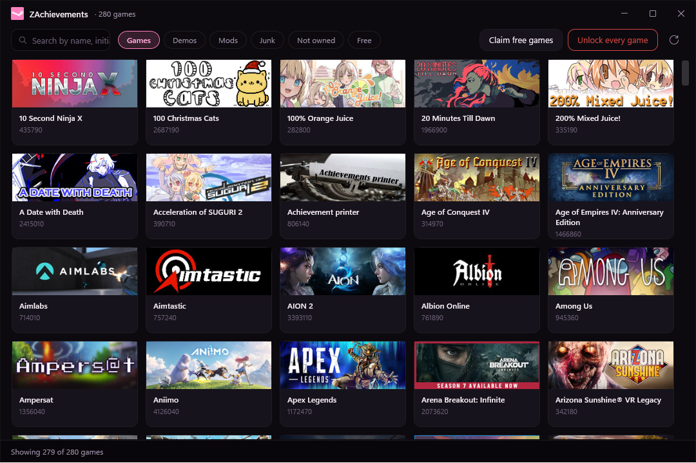
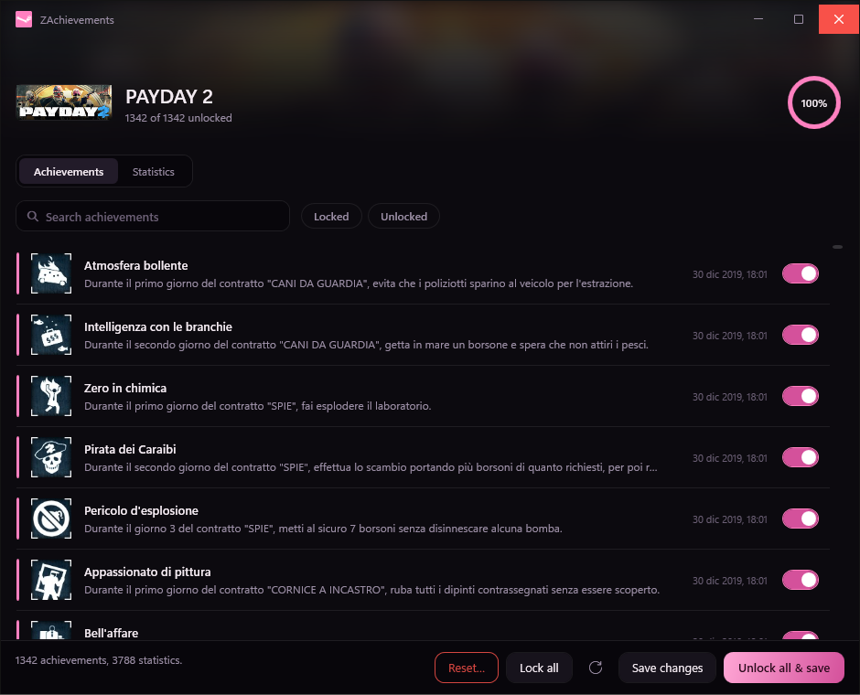

<div align="center">


# ZAchievements

**A Steam achievement manager in one executable.**<br>
No installer. No .NET runtime to install. No loose DLLs. Download, run, unlock.

[](https://github.com/Zaick99/ZAchievements/releases/latest)
[](https://github.com/Zaick99/ZAchievements/releases)
[](https://github.com/Zaick99/ZAchievements/releases/latest)
[](LICENSE.txt)

[**⬇ Download ZAchievements.exe**](https://github.com/Zaick99/ZAchievements/releases/latest)



</div>

---

## What it does

- **Unlock all & save** — one click unlocks every achievement in a game and commits it to Steam.
- **Unlock every game** — walks the whole filtered library, one game at a time, with live progress
  and a stop button.
- **Browse all of Steam, not just your shelf** — the *Not owned* filter widens the library from the
  games you own to the ~88 000 apps Steam knows, titles and store capsules included.
- **Claim free games into your account** — the *Free* filter keeps what Steam gives away, and
  ZAchievements can add those licences for you, verified one by one. [How that works](#claiming-free-games).
- **Search that gives up less** — by title, by initials (`aoe` finds *Age of Empires*), by app id,
  accent- and case-insensitive, several words at once.
- **Statistics editor** — integer and float stats, behind an explicit "I know this can break a game"
  switch.
- **Attempts protected achievements** — the ones Steam validates server side are tried anyway, and
  whatever it refuses is counted rather than treated as a crash.

<div align="center">

</div>

---

## Install

1. [Download `ZAchievements.exe`](https://github.com/Zaick99/ZAchievements/releases/latest).
2. Put it anywhere **except** the Steam folder.
3. Run it with Steam open and signed in.

That is the whole installation. One 55 MB file, self-contained, x86 — Steam's `steamclient.dll` is
32-bit, so the process has to be too.

> Windows SmartScreen will warn about it: the executable is not code-signed, because a certificate
> costs more than this tool is worth. *More info → Run anyway*, or build it yourself from source —
> the command is at the bottom of this page.

---

## How it differs from the original SAM

This is a fork of [gibbed's SteamAchievementManager](https://github.com/gibbed/SteamAchievementManager),
rebuilt rather than patched.

| | SAM | ZAchievements |
|---|---|---|
| Files to ship | two executables | **one** |
| Framework | .NET Framework 4.8, WinForms | .NET 10, WPF |
| Artwork | re-downloaded every launch, one at a time | cached on disk, eight at a time, fetched lazily |
| Game list | 2 MB of XML every launch | cached between runs |
| Library | the games you own | all of Steam, optionally |
| Free games | — | claimed into your account |
| Bulk unlock | — | the whole library, resumable |
| Protected achievements | blocked up front; one failure aborted the save | attempted, and refusals counted |

---

## Claiming free games

Steam exposes no client API for adding a licence, so ZAchievements does it the only honest way: it
opens Steam's **own store** in an embedded browser, you sign in there, and the requests run *inside
that page* — the same call the store's **Play Game** button makes. Your password, your Steam Guard
code and your session token never pass through the application. The browser profile lives in
`%LOCALAPPDATA%\ZAchievements\webview`; delete the folder and the login is gone.

Two things worth knowing before you start:

- **Steam grants only a few dozen free licences an hour.** There is no way around it. Past the quota
  Steam keeps answering `200` while granting nothing, so every claim is checked against
  `appuserdetails` afterwards: a game counts as added only when Steam says the account owns it. When
  the quota runs out the window waits a quarter of an hour and carries on.
- **Nothing is lost.** Only settled answers — granted, or nothing free to grant — are remembered.
  Games Steam silently refused stay in the queue for next time.

Tens of thousands of free games therefore take days of wall-clock time, in quarter-hour bites. Leave
the window open, or come back and press *Claim them* again.

---

## Honest limits

- **You must own the game.** Steam checks ownership on its own servers and refuses writes for
  anything else. Unowned games can be opened, but every write will bounce.
- **Protected achievements** in online and anti-cheat games are validated by Valve. ZAchievements
  tries, reports how many were refused, and moves on.
- **Unlock dates are kept by Steam.** Nothing here can undo that.
- **The Steam client lags.** A licence lands on the account immediately, but the running client can
  take a minute to notice; the count catches up on the next rescan.
- This tool changes your Steam achievement data. Use at your own risk.

---

## Caches

Artwork and catalogues live in `%LOCALAPPDATA%\ZAchievements`. Deleting that folder costs nothing but
a fresh download.

---

## Building

```bash
dotnet publish src/ZAchievements/ZAchievements.csproj -c Release -o dist
```

Needs the .NET 10 SDK. Produces a single self-contained `dist/ZAchievements.exe`.

---

## Credits

- The Steam client interop, and the whole idea, come from
  [gibbed](https://github.com/gibbed)'s SteamAchievementManager — zlib licensed, see
  [LICENSE.txt](LICENSE.txt).
- Fork, rewrite and interface by [Zaick99](https://github.com/Zaick99).

If ZAchievements saved you some clicking, a ⭐ helps other people find it.
